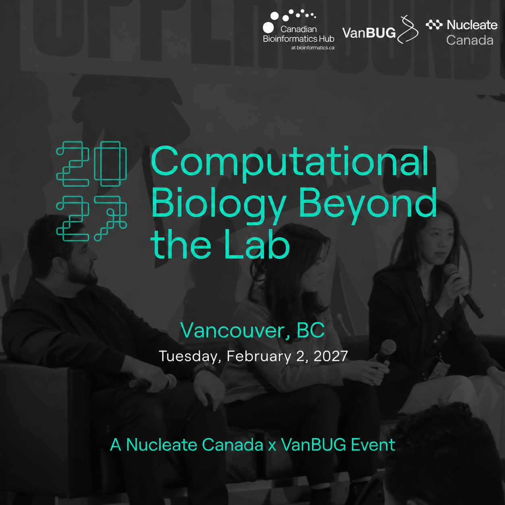

# Feb - Computational Biology Beyond the Lab

!!! info "Event Details"

    **Date/Time:**

    Tuesday, February 2nd, 2027 :material-clock: 6:00pm - 8:00pm

    **Location:**

    :material-map-marker: **Location:** UBC

{ style="display: block; margin: 0 auto; max-width: min(100%, 28rem)" }

Great science opens doors. What does it take to walk through them?

From making the leap into industry to turning a computational tool into something investors will back, translating research comes with plenty of questions. Where do you start, and how are LLMs changing the way companies work?

Join [Nucleate Canada](https://nucleate.org/chapters/canada/?utm_source=luma), the CBH BC Node, and VanBUG at UBC for a candid 60-minute panel on turning computational research into something people use. We’ll talk about careers, commercialization, and the practical role of AI in therapeutics, drug discovery and bioinformatics: where to trust a model, where to check it, and who is accountable when someone acts on its output. Bring your questions; networking to follow.

On the panel:

* Moderator: [Nairuz Elazzabi](https://www.linkedin.com/in/nairuze/?utm_source=luma) - Co-Managing Director Nucleate Canada, and a PhD candidate in bioinformatics at UBC.
* [Dr. Jenny Yang](https://www.linkedin.com/in/jennyyang259/?utm_source=luma) - Co-founder and CEO, Outpost Bio. A UBC alum who went from a Genome Sciences Centre job to an Oxford DPhil, deploying clinical ML models in live emergency departments, and then to founding a company. The founder’s view on taking a computational idea into a funded startup, and why Outpost opened its own wet lab.
* [Carolyn Ch’ng](https://www.linkedin.com/in/carolynchng/?utm_source=luma) - Senior Manager, Information Systems, Amgen. A computational biologist who moved from BC Cancer and GenomeDx into industry, and now works with Amgen’s research leaders on AI and data strategy for R&D.
* [Dr. Purang Abolmaesumi](https://www.linkedin.com/in/purang-abolmaesumi/?utm_source=luma) - Professor, UBC Electrical and Computer Engineering, and co-lead of the UBC–VGH AI Echo Core Lab. How a university lab builds medical imaging AI that reaches hospitals, including the heart-failure pilot moving into clinic at Vancouver General

**Registration:**

If you are interested in attending this event, please [register here](https://luma.com/nucleatevan-compbio27).
